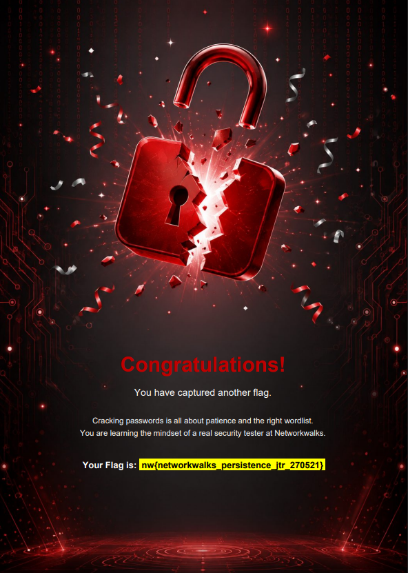

# 🔐 WEEK 03 – PASSWORD CRACKING

  
  
  

  <b>🔍 Exploring Password Recovery | Hash Analysis | Security Tools</b>

---

## 🎯 About This Week

Week 3 focuses on **Password Cracking and Password Recovery Techniques**. In these practical exercises, I explored different tools used to recover passwords from protected PDF documents.

The main objective was to understand how password hashes work and gain hands-on experience with password recovery tools in a controlled Windows environment.

## 📌 Practical Tasks

### 🔴 TASK 01 – Password Cracking with John the Ripper (JTR)

<kbd>W3-PM1</kbd>

**🎯 Objective:**

Crack the password of the provided PDF file `My Locked PDF1.pdf` using John the Ripper (JTR) and JTR Johnny tools on a Windows PC.

**🛠️ Tools Used:**

- John the Ripper (JTR)
- JTR Johnny (GUI)
- Windows PC

**⚡ Practical Activities:**

- Prepared the protected PDF for password recovery.
- Performed password-cracking operations using John the Ripper.
- Explored the graphical interface using JTR Johnny.
- Analyzed the password recovery process.
- Verified the recovered password by opening the PDF.

**📸 Practical Evidence:**

---

### 🟢 TASK 02 – Password Cracking with Networkwalks Tools

<kbd>W3-PM2</kbd>

**🎯 Objective:**

Crack the password of the provided PDF file `My Locked PDF1.pdf` using Networkwalks Hash Calculator and Password Cracker tools on a Windows laptop.

**🛠️ Tools Used:**

- Networkwalks Hash Calculator
- Networkwalks Password Cracker
- Windows Laptop

**⚡ Practical Activities:**

- Loaded the provided password-protected PDF.
- Generated the required hash using Hash Calculator.
- Used the Password Cracker tool for password recovery.
- Analyzed the cracking process.
- Verified the recovered password by opening the PDF.

**📸 Practical Evidence:**

---

## 🧰 Tools & Technologies

| Tool | Purpose |
|---|---|
| 🔴 John the Ripper | Password cracking |
| 🖥️ JTR Johnny | GUI-based password cracking |
| 🔵
